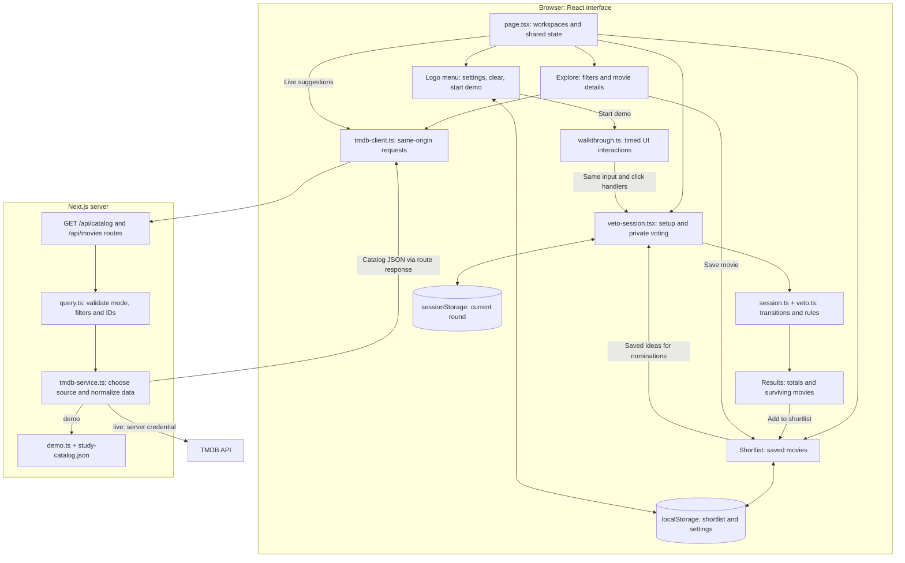

# Veto

Veto helps two to six people find movies they are willing and able to watch on one shared device. Set practical limits, add suggestions, respond privately, and keep any surviving movies in a permanent shortlist. Voting does not require the group to pick one winner.

**[Open the hosted app](https://cs422-veto.vercel.app)**

## The experience

**Setup → Suggest → Vote → Results**

1. **Setup:** enter the viewers, movie-end deadline, streaming services, accepted audio languages, and English-subtitle requirement.
2. **Suggest:** each viewer nominates a movie or explicitly skips. The group can add more options, up to six distinct movies. Clicking a title adds it immediately; known runtime conflicts appear inline.
3. **Vote:** pass the shared device between viewers. Each viewer selects, saves, reviews, and submits a complete private ballot.
4. **Results:** see the four response totals for every movie. Each survivor has an **Add to shortlist** button. Save several, one, or none; saved movies show **In shortlist**. **View shortlist** opens the collection, which remains on this device after reloading.

| Response | Meaning | Effect |
| --- | --- | --- |
| Really Want | Enthusiastic about watching | Adds to the enthusiasm count |
| Okay | Willing to watch | Adds to the willingness count |
| Prefer another | Willing, but prefers another option | Records a softer preference without eliminating the movie |
| Veto | Objects to watching | Eliminates the movie, regardless of other totals |

Each viewer has one active **preference** veto. Editing that response restores the allowance; another firm objection can pause the round. Accessibility, subtitle, audio, access, and time requirements are separate from taste and never spend a preference veto. A newly discovered access issue covers the private turn and offers a shared review with fresh ballots.

Click the **Veto logo** to open settings. **Dark mode** switches the appearance; **Live data** switches Suggest and Explore between the prepared collection and the server-backed TMDB catalog. Both preferences are remembered. The defaults are light appearance and demo data. Switching the source preserves the current round and saved movies. **Clear shortlist** removes the movies saved on this device; it is disabled when the collection is empty. **Start demo** plays the guided walkthrough described below.

## Architecture and data flow

The app uses Next.js App Router, React, and TypeScript. The browser owns the voting session and saved shortlist. The server only supplies movie catalog data; it does not receive names, ballots, or saved collections.



The credential boundary is the server service. Browser requests use relative `/api/...` URLs with a data mode and filters; only server-to-TMDB requests carry `TMDB_API_TOKEN`. Movie artwork loads separately from TMDB's image CDN.

### Where the code lives

All application code is under [`prototype/`](./prototype/).

| File | Responsibility |
| --- | --- |
| [`src/app/layout.tsx`](./prototype/src/app/layout.tsx) | Root HTML, metadata, viewport, local font imports, and global styles |
| [`src/app/page.tsx`](./prototype/src/app/page.tsx) | Home component; switches Decide together / Explore / Shortlist, owns saved movies and preferences, fetches catalog data, and renders browsing controls/details |
| [`src/components/veto-session.tsx`](./prototype/src/components/veto-session.tsx) | Renders the round, handles nomination and private-turn interactions, persists round state, and connects result buttons to Home's shortlist |
| [`src/lib/session.ts`](./prototype/src/lib/session.ts) | Session type, initialization, restoration validation, response saving/submission, voting start, pause, and fresh-round recovery |
| [`src/lib/veto.ts`](./prototype/src/lib/veto.ts) | Practical limits, candidate assumptions, eligibility, response definitions, veto rules, and aggregate totals |
| [`src/lib/tmdb.ts`](./prototype/src/lib/tmdb.ts) | Shared movie/catalog/filter types, default filters, discovery URL construction, filter bounds, and artwork URLs |
| [`src/lib/catalog.ts`](./prototype/src/lib/catalog.ts) | Shared genre modes, runtime ranges, decade/rating options, and selection limits |
| [`src/lib/movie.ts`](./prototype/src/lib/movie.ts) | Validates and normalizes stored movie records; removes invalid entries and duplicate IDs |
| [`src/lib/demo.ts`](./prototype/src/lib/demo.ts) | Exposes the prepared movies/options and applies equivalent local discovery filters and sorting |
| [`src/lib/study-catalog.json`](./prototype/src/lib/study-catalog.json) | One dated collection of real movie metadata, provider listings, and provenance |
| [`src/lib/tmdb-client.ts`](./prototype/src/lib/tmdb-client.ts) | Browser API functions, canonical query serialization, cancellation, and readable request errors |
| [`src/app/api/`](./prototype/src/app/api/) | Thin GET handlers for catalog options, movie pages, and movie details |
| [`src/lib/server/query.ts`](./prototype/src/lib/server/query.ts) | Independent server validation, API errors, cache durations, and response headers |
| [`src/lib/server/tmdb-service.ts`](./prototype/src/lib/server/tmdb-service.ts) | Server-only source selection, authenticated upstream fetching, response normalization, and sanitized failures |
| [`src/components/demo-walkthrough.tsx`](./prototype/src/components/demo-walkthrough.tsx), [`src/lib/walkthrough.ts`](./prototype/src/lib/walkthrough.ts), [`src/app/demo.css`](./prototype/src/app/demo.css) | Playback controls/captions, the five-viewer interaction script, pointer/ripple animation, and presentation layout |
| [`src/components/settings-menu.tsx`](./prototype/src/components/settings-menu.tsx) | Logo dropdown with theme/source toggles, shortlist clearing, guided-demo launch, keyboard navigation, and outside-click dismissal |
| [`src/components/dialog.tsx`](./prototype/src/components/dialog.tsx) | Shared native dialog and movie-details modal behavior |
| [`src/components/movie-poster.tsx`](./prototype/src/components/movie-poster.tsx) | Artwork display and fallback when an image is absent or fails |
| [`src/app/globals.css`](./prototype/src/app/globals.css), [`src/app/veto.css`](./prototype/src/app/veto.css) | Shared colors, browsing UI, light/dark appearance, session states, and responsive layouts |

### Data model

| Type | Contents and purpose |
| --- | --- |
| `Movie` | Stable TMDB ID, title, synopsis, artwork paths, date, original language, genres, ratings, and optional runtime/provider IDs |
| `Catalog` / `MoviePage` | Available filter options and source mode / a paginated result list |
| `Filters` | Selected genres and any/all mode, original language, runtime band, decade, rating floor, sort, and streaming providers |
| `Limits` | Viewer count, concrete end timestamp, agreed service IDs, audio codes, and subtitle requirement |
| `Candidate` | A movie plus assumed service/audio/subtitle/access fields and who nominated it; group additions use no individual owner |
| `Ballot` | A map from candidate movie IDs to the four response values |
| `Session` | Current phase, limits, names, candidates, nomination/viewer/movie positions, saved current-turn responses, submitted ballots, and excluded title IDs |

### How a round progresses

`veto-session.tsx` handles the interface; `session.ts` returns new session objects for the core transitions. Keeping these functions separate lets tests check the rules without a browser.

| Internal phase | What happens next |
| --- | --- |
| `setup` | Validate a future deadline and at least one service/audio option, then open suggestions |
| `suggest` | Add or skip each viewer's nomination; optionally add group choices; `startVoting` rechecks eligibility before handoff |
| `handoff` | Cover responses until the next viewer explicitly begins; after the final submission, offer group results |
| `vote` | Keep a tentative selection in component memory; `saveResponse` records it in the current draft and advances the movie |
| `review` | Show the current viewer's saved responses for correction; `submitTurn` requires a complete ballot, clears the draft, and covers the next turn |
| `choose` | Historical internal name for the **Results** stage; display totals and allow independent shortlist saves for every survivor |
| `paused` | Conceal the active private turn; resume through handoff or agree to a fresh round |
| `stopped` | End the evening without requiring a selected movie |

`assumeCandidate` retains a known positive runtime or uses 120 minutes. It prefers matching provider/original-language metadata, otherwise the first agreed service/audio option, and assumes the agreed subtitle/access conditions. `eligibility` checks runtime against the time window, service/audio agreement, required subtitles, and access. These practical checks apply when preparing and starting a round.

`tally` counts all four responses in candidate order. Any veto eliminates the movie; enthusiasm cannot override it, and totals do not rank or automatically select a winner. Results let any number of survivors enter the permanent shortlist. Saving is independent of the original deadline because the shortlist also holds ideas for later.

Home's `addSaved` callback adds by movie ID only when absent. Result buttons become disabled **In shortlist** buttons once saved. Explore/details retain their separate save/remove toggle. Neither action writes to the voting ballots.

`restartSession` explains and resets nominations/ballots while keeping the agreement and actual recorded objections. Reviewing limits returns to Setup; another set returns to Suggest. Deliberate reconsideration releases rejected IDs only after agreement. Restoring an active private vote/review always shows its cover first. Older stored `confirm`/`done` rounds migrate to Results, retaining all completed ballots and candidates rather than enforcing their previous single choice.

### The automated live-demo walkthrough

Open the logo menu and select **Start demo**. The roughly two-minute presentation uses prepared data, a party of **Maya, Leo, Priya, Sam, and Alex**, and five real movies. It fills out setup, enables Hindi/Tamil audio and required English subtitles, searches for each nomination, completes five private ballots, explains two vetoed titles, and saves the three survivors: Glass Onion, Maharaja, and The Adam Project.

The walkthrough operates the actual interface. `walkthroughSteps` builds the ordered script; `runWalkthrough` finds controls through stable `data-demo` attributes, scrolls them into view, moves a pointer, shows click ripples, calls the normal button click handlers, and types through native input/change events. It does not insert completed ballots or results. The same eligibility checks, response-saving functions, tally, and shortlist callbacks used manually produce the demonstrated outcome.

Step weights distribute the presentation across 120 seconds, with short reading pauses and captions for each chapter. The driver waits for controls to render and respects **Pause / Resume**, **Restart / Replay**, and **Exit demo** (also Escape). Reduced-motion settings remove animated scrolling and ripples while retaining the walkthrough.

Demo state is separate from personal state: Home uses a temporary in-memory movie collection, the session skips browser-storage writes, and source preferences are not persisted during playback. Exit restores the previous workspace, data source, saved movies, and round. The underlying interface is inert during playback so stray clicks cannot disrupt the presentation; the playback controls remain available. Reloading also returns to personal data.

### Explore and the catalog API

In demo mode, the decision flow uses the prepared collection immediately, and discovery requests begin when Explore is opened. Selecting live mode also fetches movies for suggestions. Home aborts pending catalog/list/detail requests when the source changes, clears stale results, and refetches with the explicit mode. Saved movies remain available for nominations in either mode.

All endpoints accept same-origin `GET` requests and return JSON:

| Endpoint | Response | Shared-cache interval |
| --- | --- | --- |
| `/api/catalog` | Source mode, genres, languages, and providers | 24 hours |
| `/api/movies` | A filtered/sorted movie page | 15 minutes for the landing list; 5 minutes for filtered lists/later pages |
| `/api/movies/<id>` | One movie with detail/runtime information | 6 hours |

`mode=demo` always selects the prepared collection, even if a token is configured. `mode=live` requires the server token and returns a readable 503 when unavailable. Omitting mode retains automatic selection from server configuration. The interface sends mode explicitly, and distinct URLs keep the sources' cache entries separate.

The list endpoint supports `genres`, `genreMode`, `language`, `runtime`, `year`, `rating`, `sort`, `providers`, and `page`. Genre/provider sets are deduplicated and serialized in numeric order. The server rejects unknown/repeated parameters, unsupported options, invalid IDs, more than 20 IDs per set, oversized filter queries, and pages outside 1–500. Sharing option definitions with the browser does not replace server validation.

The service uses the same response shapes for local and live data. Demo pages contain up to 20 movies. Live requests use TMDB discovery/details/configuration endpoints, a ten-second timeout, normalized fields, and server-side caching. Authentication, timeout, rate-limit, missing-movie, and malformed-response errors become sanitized JSON errors; errors use `no-store`. Successful routes set shared-cache headers and `nosniff`. Upstream and CDN refreshes are independent, so the intervals do not guarantee a maximum data age.

### Persistence and privacy

| Storage key | Location | Lifetime and contents |
| --- | --- | --- |
| `veto-session-v1` | `sessionStorage` | Current round, names, and saved/submitted responses; survives a reload in that tab |
| `movie-night-shortlist-v1` | `localStorage` | Permanent saved movie collection across reloads and later visits on the same browser; the older key name preserves existing saves |
| `veto-preferences-v1` | `localStorage` | Light/dark theme and demo/live source preferences |

There is no application database or account synchronization. Clearing browser storage removes local saves. Stored movie records are normalized by `parseMovie`/`parseSavedMovies`; round restoration validates its structure, candidates, ballot completeness, response values, and phase invariants. Failed shortlist writes keep the current collection in memory and explain the persistence limit.

Tentative voting selections are not saved until **Save & next**. Handoff protects against ordinary on-screen exposure, while aggregate totals can still allow inference. Browser storage is not encrypted ballot storage. The catalog API neither receives nor stores the group's voting data.

### Appearance and interaction

`layout.tsx` loads DM Sans locally. Shared CSS variables define cream/ink/teal colors and their dark equivalents; `data-theme` on the root element selects the palette. Responsive grids adapt setup, cards, filters, ballots, and results for desktop and mobile. Text and symbols accompany colors for selected/eliminated states.

The session moves keyboard focus to the current viewer/movie or recovery heading; opening Explore or Shortlist focuses that workspace's heading. The settings menu supports arrow keys, Home/End, Escape, Tab, and outside clicks, with checked-state announcements for both toggles. Movie details use a native modal dialog. Shared poster rendering provides an artwork fallback. Status messages distinguish tentative, saved, submitted, and permanently shortlisted actions.

## Run locally

Use **Node.js 24** and **pnpm 11.19.0**. The app and its package scripts are in `prototype/`; the included Nix shell is optional.

```sh
cd prototype
# Optional on Nix: nix develop
pnpm install --frozen-lockfile
cp .env.example .env.local
pnpm dev
```

Open <http://localhost:3000>. Leave `TMDB_API_TOKEN` blank for demo mode. To enable live data, set a TMDB application read-access token or v3 API key in `.env.local`. The token remains on the server; visitors do not supply credentials. An invalid live credential produces an error rather than silently changing sources.

For a production preview, stop the development server, run `pnpm build`, then `pnpm start`.

## Validation and configuration

```sh
cd prototype
pnpm lint
pnpm typecheck
pnpm test:unit
pnpm exec playwright install chromium
pnpm test:e2e
```

| Test file | What it verifies |
| --- | --- |
| `movie.test.ts` | Safe normalization, legacy saved records, deduplication, and collections over 100 titles |
| `session.test.ts` | Valid restoration, covered private turns, response correction, recovery, accessibility rules, and legacy result migration |
| `veto-engine.test.ts` | Assumptions, practical eligibility, runtime boundaries, response counts, and veto elimination |
| `study-catalog.test.ts` | Prepared multilingual and recovery examples remain supported by the dated collection |
| `server.test.ts` | Query/client URL contracts, source selection, credentials, upstream failures, validation, and caching |
| `api.spec.ts` | Actual route-handler requests and an unintercepted browser-to-API browsing/save flow |
| `prototype.spec.ts` | Discovery filters, details, retries, stored shortlist recovery, limits, and write failures |
| `settings.spec.ts` | Persistent preferences, keyboard menu controls, source changes, errors, and request cancellation |
| `walkthrough.test.ts`, `walkthrough.spec.ts` | Five-viewer story coherence, three truthful survivors, UI-driven playback, pause/replay/exit, personal-data isolation, and persistent shortlist clearing |
| `veto-flow.spec.ts` | Nominations, private turns, totals, veto/access review, recovery, multiple survivor saves, persistence, and older completed rounds |

Node runs the pure/server tests with the React server condition and TypeScript loader. Playwright runs desktop and iPhone 13 projects. By default it builds and owns a production demo server at `http://127.0.0.1:3001`, using no TMDB secret. Stop a development server first because the build shares `.next/`. `PLAYWRIGHT_CHROMIUM_EXECUTABLE_PATH` selects a compatible system Chromium binary; `BASE_URL` selects an existing external app. API checks explicitly request demo mode for repeatable results.

[GitHub CI](./.github/workflows/ci.yml) uses Node 24, a frozen install, lint, type checking, unit tests, and the production browser suite. It uses no catalog secret. These checks establish implementation behavior; they do not verify a streaming account or replace a participant study.

| Configuration | Purpose |
| --- | --- |
| `package.json`, `pnpm-lock.yaml`, `pnpm-workspace.yaml` | Scripts, pinned dependencies/package manager, reproducible installation, and approved dependency build steps |
| `tsconfig.json`, `next-env.d.ts`, `eslint.config.mjs` | TypeScript/Next integration and lint rules |
| `next.config.ts` | Disable the framework identification header and development indicator |
| `playwright.config.ts` | Owned production test server, external-server override, browser matrix, and failure traces |
| `vercel.json` | Next.js deployment framework and `iad1` region |
| `.env.example`, `.gitignore`, `.vercelignore` | Document server configuration and exclude credentials, build output, local metadata, and working documentation |
| `flake.nix`, `flake.lock` | Optional pinned Nix development environment |

## Data, hosting, and scope

The prepared collection contains **31 real films**, with TMDB metadata and US streaming listings retrieved on **November 9, 2026**. For this classroom prototype, suggestions assume agreed streaming/audio/subtitle access and no extra charge. Known runtime conflicts remain active; missing runtime uses 120 minutes. Original language is movie metadata, not verification of an available dub. Prepared listings and live metadata do not verify current account playback.

Deploy `prototype/` as a Next.js app on Node.js 24 and configure `TMDB_API_TOKEN` on the server when live data is needed. `main` is the single maintained version, combining the decision workflow and catalog backend. There are no remote rooms, accounts, learned rankings, automatic winners, or playback integration.

This is Team 9's CS422 functional prototype; the [ecologylab assignment](https://ecologylab.net/courses/ui/deliverables/functional.html) provides its course context. Research notes, presentation planning, and other working documentation stay local. The root README is the public code and usage guide.

This product uses the TMDB API but is not endorsed or certified by TMDB. Movie metadata and artwork belong to their respective owners; streaming listings are provided by [JustWatch](https://www.justwatch.com/).
