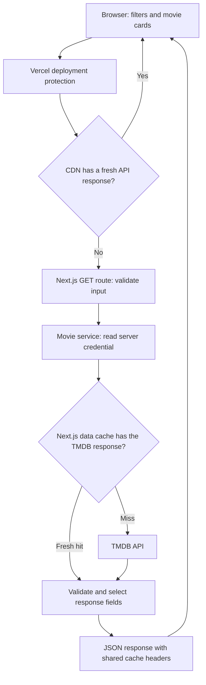

# Movie catalog API and caching

The Veto interface and these server endpoints ship together from `main`.

## How requests move through the app



The diagram shows the normal fresh-hit/miss paths; stale refreshes are explained below. In local development there is no Vercel CDN or deployment-protection layer.

1. On page load, [the client component](../src/app/page.tsx) calls `fetchCatalog()` in [tmdb-client.ts](../src/lib/tmdb-client.ts). The browser sends `GET /api/catalog` to the same origin that serves the app.
2. Once catalog metadata is available, the client waits **200 ms** and requests `GET /api/movies`. Every filter change resets pagination to page 1. Further changes cancel the pending timer and browser request; ignored/aborted results cannot overwrite newer selections.
3. Opening a movie sends `GET /api/movies/<id>` for its runtime and full details. The card data stays visible while details load. Closing/changing the selection aborts the browser request.
4. Route handlers validate incoming parameters and call [tmdb-service.ts](../src/lib/server/tmdb-service.ts). That module authenticates to TMDB, requests JSON, validates its shape, and returns only the fields the app uses.
5. Images use `https://image.tmdb.org/t/p/w500/<filename>` directly from the browser. They do not pass through these API routes or use their cache lifetimes.

The first uncached live visit needs two browser API requests (catalog, then movies), resulting in **four upstream TMDB requests**: three parallel metadata requests plus one Discover request. A detail click adds one. Cache hits can reduce this work. Aborting a browser request does not guarantee cancellation of work already running on the server; the direct upstream request has its own 10-second timeout. Framework background revalidation has a separate caveat described under caching.

### Where the credential goes

Set `TMDB_API_TOKEN` to your [TMDB application API Read Access Token](https://www.themoviedb.org/settings/api). A v3 API key is also accepted. Never prefix this variable with `NEXT_PUBLIC_`. `.env.local` and `.vercel` project metadata are ignored by Git; environment files are also excluded from deployment uploads.

`movieService()` reads the variable on the server. The service trims whitespace and an optional `Bearer ` prefix. A 32-character hexadecimal credential becomes the upstream `api_key` query parameter; otherwise the request uses `Authorization: Bearer <token>`. Both forms send `Accept: application/json`. The credential is never copied into the JSON response, browser bundle, browser storage, or browser request headers. The module is marked `server-only` to prevent importing it into a client component.

Browser requests use `credentials: "same-origin"`, so the browser can send its Vercel access cookie to this site. This cookie is separate from the TMDB credential. Visitors do not enter a TMDB credential.

Without a configured token, the server serves the local sample catalog and `/api/catalog` returns `mode: "demo"`. Sample provider assignments are illustrative. An invalid configured credential raises a recoverable error; it does not silently switch to demo data.

## API endpoints and response objects

These are the app's own endpoints, not TMDB endpoint names. They all use `GET` and return JSON when reached through deployment protection. They accept no request body or visitor-supplied API key.

| App endpoint | Upstream TMDB request, relative to `https://api.themoviedb.org/3` | Success body |
| --- | --- | --- |
| `/api/catalog` | `/genre/movie/list?language=en-US`, `/configuration/languages`, and `/watch/providers/movie?watch_region=US&language=en-US` in parallel | `Catalog` object |
| `/api/movies` | `/discover/movie` with the translated filters below | `MoviePage` object |
| `/api/movies/<id>` | `/movie/<id>?language=en-US` | One normalized `Movie` object, not a page |

`/api/catalog` and `/api/movies/<id>` reject every query parameter. The movie-list endpoint accepts only the documented parameters. All examples below are **illustrative fixtures**, not claims about current titles, ratings, counts, or availability.

### Catalog: IDs and labels for filter controls

```json
{
  "mode": "live",
  "genres": [{ "id": 16, "name": "Animation" }],
  "languages": [{ "iso_639_1": "en", "english_name": "English", "name": "English" }],
  "providers": [{ "provider_id": 8, "provider_name": "Netflix", "logo_path": null, "display_priority": 0 }]
}
```

| Object/field | Meaning and use |
| --- | --- |
| `Catalog.mode` | `"live"` or `"demo"`; drives the UI's data-source label. |
| `Genre.id`, `Genre.name` | Numeric ID used in requests and readable label shown on a chip. |
| `Language.iso_639_1` | Two-letter original-language filter, such as `en` or `ja`. |
| `Language.english_name`, `Language.name` | English display label and native/local language name. |
| `Provider.provider_id`, `Provider.provider_name` | Service ID used in discovery and its readable label. |
| `Provider.logo_path` | TMDB image path or `null`, not a complete URL. |
| `Provider.display_priority` | Sort hint; the server supplies `9999` if absent, then sorts by priority and name. The UI promotes a few familiar services separately. |

TMDB's metadata envelopes differ: genres arrive under `{ genres: [...] }`, languages arrive as a bare array, and providers arrive under `{ results: [...] }`. The server combines them into the `Catalog` envelope above. Languages with invalid two-letter codes or empty English names are removed and the remainder sorted by English name.

A provider directory says which services can be selected in the USA; it does **not** say that every movie is available on those services. Live movie availability filtering happens inside TMDB Discover. The app does not fetch per-movie `/watch/providers` data; the details link opens TMDB's US watch-options page.

### MoviePage and Movie: list versus details

```json
{
  "page": 1,
  "total_pages": 1,
  "total_results": 1,
  "results": [{
    "id": 123,
    "title": "Example Movie",
    "overview": "An illustrative synopsis.",
    "poster_path": "/example.jpg",
    "backdrop_path": null,
    "release_date": "2024-01-01",
    "vote_average": 7.5,
    "vote_count": 1200,
    "popularity": 42.1,
    "genre_ids": [16, 35],
    "original_language": "en"
  }]
}
```

`MoviePage.results` contains `Movie` objects. `page` is one-based; `total_results` counts all matches, not just the current page. `total_pages` is capped at 500, so a very large result count does not mean every result is accessible through pagination. Demo mode slices its local results into 20-item pages.

| Movie fields | Meaning |
| --- | --- |
| `id` | Stable TMDB movie ID; used in detail URLs and shortlist comparisons. |
| `title`, `overview` | Display title and synopsis. Response text is requested in English (`en-US`), independent of the original-language filter. |
| `poster_path`, `backdrop_path` | Relative image path or `null`. The server accepts only a slash plus a safe filename; `imageUrl()` adds the image-CDN base and size. |
| `release_date` | Date string, normally `YYYY-MM-DD`; missing data becomes an empty string. |
| `vote_average`, `vote_count` | Average audience score on TMDB's 0–10 scale and number of votes. |
| `popularity` | TMDB's separate popularity metric, not a rating percentage. |
| `genre_ids` | Numeric IDs joined to `Catalog.genres` for labels. |
| `original_language` | Original-language code joined to `Catalog.languages`; it does not describe available dubbing or subtitles. |
| `runtime` (optional) | Minutes, added when a valid numeric runtime is returned by the detail endpoint. Missing/null runtime is omitted; zero is not displayed as a known runtime. |
| `provider_ids` (optional shared type) | Local demo assignments only. The live service never adds this field and Discover does not return it. |

The [shared TypeScript types](../src/lib/tmdb.ts) define `Genre`, `Language`, `Provider`, `Movie`, `MoviePage`, and the local UI `Filters` object. The server's `movie()` parser constructs a new object from allowed fields; it does not forward arbitrary TMDB fields. It converts detail responses from `genres: [{ id, name }]` to `genre_ids: [id]`, keeping the UI shape consistent with Discover results. The detail response for the fixture would have the same movie fields plus, for example, `"runtime": 85`, without the `results` envelope.

Discover can filter by runtime even though its result objects do not contain runtime. This is why cards can match “90 minutes or less” before the app knows the exact number of minutes for a detail dialog.

### Query contract and translation to TMDB

The local `Filters` object holds arrays for `genres`/`providers` and strings for the other controls. `page` is separate state. [tmdb-client.ts](../src/lib/tmdb-client.ts) serializes it; [query.ts](../src/lib/server/query.ts) parses it; [buildDiscoverUrl()](../src/lib/tmdb.ts) constructs the upstream URL.

| App query parameter | Accepted value/default | TMDB translation |
| --- | --- | --- |
| `genres` | Comma-separated positive IDs; default none | `with_genres=16|35` for any, or `16,35` for all |
| `genreMode` | `any` (default) or `all` | Chooses OR (`|`) or AND (`,`) within `with_genres` |
| `language` | Two lowercase letters, or empty/default | `with_original_language=en`; response `language=en-US` stays fixed |
| `runtime` | Empty, `short`, `medium`, `long`, `epic` | `with_runtime.gte/lte`: 1–90, 91–120, 121–180, or 181 with no upper bound |
| `year` | Empty, `classic`, `1990`, `2000`, `2010`, `2020` | `primary_release_date.gte/lte`; classic ends 1989-12-31, other decades cover their ten years but never extend past today's UTC date |
| `rating` | Empty, `6`, `7`, `8` | `vote_average.gte`; independent of the fixed minimum vote count |
| `sort` | Default `popularity.desc` | `sort_by`; allowed fields are `popularity`, `vote_average`, `primary_release_date`, `title`, `vote_count`, each with `.asc` or `.desc` |
| `providers` | Comma-separated positive IDs; default none | `with_watch_providers=8|9`, `watch_region=US`, `with_watch_monetization_types=flatrate|free|ads` |
| `page` | Integer 1–500; default 1 | `page` |

Comma-separated IDs in **our API** are a serialization format, not a promise of AND matching. The server translates them to TMDB's syntax. Separate filter categories combine: an English, short, animated selection with Netflix chosen must satisfy all those categories. Multiple streaming services always mean any selected service. The USA restriction is for streaming availability, not a restriction to movies made in the USA. No service selected means no watch-provider restriction. [TMDB documents these Discover parameters and operators](https://developer.themoviedb.org/reference/discover-movie).

Every live Discover request also sends `language=en-US`, `include_adult=false`, `include_video=false`, `vote_count.gte=100`, and an upper primary-release-date bound (today in UTC unless an earlier decade boundary applies). The date comes from the server clock, not the visitor's timezone.

Worked example: “animation or comedy, English, at most 90 minutes, rating 7+, Netflix or Prime Video”:

```text
GET /api/movies?genres=16%2C35&genreMode=any&language=en&runtime=short&rating=7&providers=8%2C9
```

The translated TMDB query is shown decoded below for readability; `URLSearchParams` encodes commas and pipes in the actual URL. `TODAY_UTC` is an explanation placeholder replaced by the current date in code.

```text
GET https://api.themoviedb.org/3/discover/movie
  ?language=en-US
  &include_adult=false
  &include_video=false
  &vote_count.gte=100
  &sort_by=popularity.desc
  &page=1
  &primary_release_date.lte=TODAY_UTC
  &with_genres=16|35
  &with_original_language=en
  &with_runtime.gte=1
  &with_runtime.lte=90
  &vote_average.gte=7
  &with_watch_providers=8|9
  &watch_region=US
  &with_watch_monetization_types=flatrate|free|ads
```

Input limits are enforced before TMDB is called: no unknown or repeated keys, serialized query length at most 2,048 characters, at most 20 entries per ID list before deduplication, and IDs from 1 to 2,147,483,647 without leading zeros. The movie path ID has the same numeric bounds. Language validation checks format, not membership in the metadata list. Arbitrary upstream URLs, credentials, and regions are not accepted.

### Errors

Application errors have one shape:

```json
{ "error": "Invalid runtime filter." }
```

| HTTP status from this app | Trigger |
| --- | --- |
| `400` | Invalid filter, repeated/unknown parameter, unexpected query, or invalid movie ID |
| `404` | TMDB movie not found, or movie absent from demo catalog |
| `503` | TMDB rejects the configured credential (upstream 401/403), or rate-limits it (upstream 429) |
| `502` | Other upstream failure, network/JSON failure, or malformed data |
| `504` | Direct upstream timeout/abort; the service supplies a 10-second timeout signal |
| `500` | Unexpected internal error, with a generic message |

Upstream response bodies and raw exception messages are not relayed to visitors. Every application error response carries `no-store` on all three cache-control headers. Vercel's login redirect is outside this JSON contract: a visitor must first open the complete tester link or have project access. The UI's Retry button reissues the same request; it does not purge a cache or automatically retry in a loop.

## Shared caching

Caching reuses previous catalog responses across visitors. It is implemented by Next.js and Vercel, not by a module-level JavaScript map, Redis, or a scheduled job. The landing **movie JSON** is cached independently of the page HTML and static assets.

### Two layers, two kinds of saved work

| Layer | What is stored | What a fresh hit avoids |
| --- | --- | --- |
| Vercel CDN | Completed JSON response for the app request URL | Running the Next.js API handler and making a TMDB request |
| Next.js persistent data cache | Raw upstream TMDB fetch response for its URL and request options | Calling TMDB; the handler still validates/transforms data and returns JSON |
| Browser/UI | Current React state and the local shortlist | Not a shared catalog cache; no application-level response cache is implemented in the browser |

The upstream cache is enabled explicitly inside `createMovieService().request()`:

```ts
// Simplified excerpt; endpoint construction and error handling are omitted.
fetch(url.toString(), {
  headers, // Server-side TMDB authorization and Accept header.
  cache: "force-cache",
  next: { revalidate: seconds },
  signal: AbortSignal.timeout(10_000),
  redirect: "error",
});
```

Next.js matches a fetch by its URL and request options, including headers. The same server credential is used for everyone, so matching requests can share entries. Cache storage is managed by the framework/platform rather than one function instance's memory. This is persistent fetch caching, not React's render-pass request memoization; these calls run in Route Handlers. [Next.js fetch reference](https://nextjs.org/docs/app/api-reference/functions/fetch).

### Lifetimes and headers

[query.ts](../src/lib/server/query.ts) contains the central `CACHE_SECONDS` values. The same value is used for the upstream fetch's `next.revalidate` and the outgoing API response's `s-maxage`.

| Data | Seconds | Interval |
| --- | --- | --- |
| Landing movie list | `900` | 15 minutes |
| Filtered lists or later pages | `300` | 5 minutes |
| Catalog metadata (each upstream request and combined API response) | `86400` | 24 hours |
| Movie details | `21600` | 6 hours |

“Landing” means page 1, default `popularity.desc` sort, and no genres, providers, language, runtime, year, or rating. `genreMode` alone has no effect without selected genres and does not shorten the interval. Page 2 or changing any effective selection above uses 300 seconds.

For the landing response, `sharedCacheHeaders(900)` emits:

```http
Cache-Control: public, max-age=0, s-maxage=900, stale-while-revalidate=60
CDN-Cache-Control: public, s-maxage=900, stale-while-revalidate=60
Vercel-CDN-Cache-Control: public, s-maxage=900, stale-while-revalidate=60
X-Content-Type-Options: nosniff
```

`public` allows shared caching of this common catalog data; it does not disable Vercel deployment protection. `max-age=0` gives the browser no fresh reuse interval. `s-maxage` sets the shared-cache interval. `stale-while-revalidate=60` lets the CDN serve an expired response for a further 60 seconds while refreshing it. Vercel uses its dedicated header first and consumes it before sending the response to the browser, so DevTools will not show every origin header. [Vercel cache-control header reference](https://vercel.com/docs/caching/cache-control-headers).

### What happens when people open the landing page

1. With both caches empty, the first `/api/movies` request runs the handler, fetches TMDB, stores the upstream response, and returns a cacheable JSON response.
2. Another visitor requesting the same URL while its CDN entry is fresh can receive that JSON without running the handler. A CDN miss can still find a fresh Next.js data-cache entry and avoid TMDB.
3. Once an entry is stale, a later request triggers refresh work. There is no timer that contacts TMDB every 15 minutes when nobody is visiting. Next.js time-based revalidation can serve previously cached data while it refreshes; the CDN has its own 60-second stale window.
4. After refresh succeeds, later requests can use the updated entry. A browser reload or Retry is not a forced fresh TMDB read.

The two layers have independent ages. A CDN refresh may receive an already-cached upstream result and cache that JSON again, so “15 minutes” is **not a strict maximum age for the movie data**. Background refresh delays and failures can also extend age. This prototype favors reuse over immediate updates; do not treat availability or ratings as real-time. Cache eviction, regional cold entries, and simultaneous cold requests also mean this is not a guarantee of exactly one TMDB call worldwide per interval.

### Cache keys and equivalent selections

The browser sorts/deduplicates genre and provider IDs, writes query parameters in a fixed order, and omits most defaults (notably `page=1` and `sort=popularity.desc`). It does include `genreMode=any` when genres are selected. Thus normal visitors use `/api/movies` for the default landing request and the same URL for the same selections.

The server independently sorts/deduplicates IDs before building the TMDB URL. For example, these hand-written app requests both produce the same upstream request:

```text
/api/movies?genres=35,16,35&providers=9,8
/api/movies?genres=16,35&providers=8,9
```

They can share the **Next.js data-cache entry**. They are not redirected to a single canonical app URL, so do not assume every equivalent spelling shares one CDN entry. Different filters, sort order, and pages generally produce different upstream entries; irrelevant values such as `genreMode` without genres do not. The discovery URL includes the UTC release-date bound: queries capped at “today” acquire a different upstream key after UTC midnight, but an existing CDN response does not immediately disappear. Completed-decade bounds remain fixed.

### Scope, failures, and changing the policy

Only common movie/catalog data is shared. A shortlist stays under `movie-night-shortlist-v1` in that browser's `localStorage`; it is never sent to these endpoints or mixed into a cached response. Demo-mode JSON gets the same response-cache policy but makes no upstream calls.

Errors generated by the routes are marked `no-store`. Next.js caches successful HTTP 200 upstream responses; a malformed HTTP 200 body can enter the fetch cache before our schema validation rejects it, even though the resulting API error is not CDN-cached. If valid upstream data was cached earlier, a failed refresh may leave that stale data available. This app does not set a CDN `stale-if-error` directive or implement a retry queue. The service supplies a 10-second abort signal for direct requests, but the installed Next.js fetch implementation removes that signal for its background stale revalidation. It is therefore not a guaranteed 10-second bound on framework background refreshes.

Change `CACHE_SECONDS` to adjust both layers together, then redeploy. Existing entries are not a synchronized live view of changed settings or TMDB: the app has no cache tags, `revalidateTag`/`revalidatePath` calls, purge endpoint, or manual refresh control. CDN and data-cache invalidation are separate concerns; do not assume a browser refresh or deployment clears every upstream entry. Credential rotation changes the upstream request key, but an already cached API response can still be served without reading the new credential.

Caching reduces repeated work for popular queries. Unique filter combinations still need work when cold, and the app has no per-user quota or distributed rate limiter. Timeouts and input bounds limit individual requests, not the total request rate.

### Inspecting the API and cache

Run a production build locally when inspecting behavior (`pnpm build`, then `pnpm start`). `next dev` and browser hard reloads can use different cache behavior; local `next start` also has no Vercel CDN.

```sh
# Local JSON contracts; no credential should be supplied by the client.
curl -i 'http://localhost:3000/api/catalog'
curl -i 'http://localhost:3000/api/movies?genres=16&genreMode=any&providers=8'
curl -i 'http://localhost:3000/api/movies/324857'
# Deliberately invalid: expect HTTP 400 and no-store.
curl -i 'http://localhost:3000/api/movies?runtime=90'
```

On a hosted deployment, inspect `x-vercel-cache` and `Age` when present. A CDN hit describes the response cache; a miss alone does not prove an upstream TMDB request occurred. Deployment protection and cache configuration depend on the host.

## Filter behavior

Genres match **any** selection by default; the checkbox enables **all** matching. Original language filters the movie's original language, while descriptions use English. Runtime ranges are 1–90, 91–120, 121–180, or 181+ minutes. Live discovery excludes future releases, adult/video entries, and movies with fewer than 100 votes.

Streaming matches any selected provider in **USA**, with subscription, free, and ad-supported offers; rental/purchase-only offers are excluded. No selected service means no streaming-availability restriction. Discover results do not include runtime; details load it on demand. Shared-device nominations and private-turn voting are provided by Veto; multi-device rooms and ballot synchronization are outside this prototype.

## Source map

| File | Responsibility |
| --- | --- |
| [page.tsx](../src/app/page.tsx) | Browser state, request timing, dialogs, and shortlist storage |
| [tmdb-client.ts](../src/lib/tmdb-client.ts) | Same-origin fetches and canonical browser query serialization |
| [tmdb.ts](../src/lib/tmdb.ts) | Shared object types, filter bounds, upstream URL builder, and image URLs |
| [server/query.ts](../src/lib/server/query.ts) | Input validation, lifetime selection, cache headers, and JSON errors |
| [server/tmdb-service.ts](../src/lib/server/tmdb-service.ts) | Credential boundary, persistent upstream fetch cache, data parsing, and demo/live mode |
| [catalog route](../src/app/api/catalog/route.ts), [movies route](../src/app/api/movies/route.ts), [detail route](../src/app/api/movies/%5Bid%5D/route.ts) | GET handlers connecting validation, service calls, and response policy |
| [server tests](../tests/server.test.ts), [browser tests](../tests/prototype.spec.ts) | Request/cache-option contracts and desktop/mobile UI behavior |

## Attribution

This product uses the TMDB API but is not endorsed or certified by TMDB. Movie information and artwork belong to their respective owners. Streaming availability is provided by [JustWatch](https://www.justwatch.com/).

References: [TMDB Discover](https://developer.themoviedb.org/reference/discover-movie), [TMDB authentication](https://developer.themoviedb.org/docs/authentication-application), [Next.js fetch caching](https://nextjs.org/docs/app/api-reference/functions/fetch), [Vercel cache headers](https://vercel.com/docs/caching/cache-control-headers).
