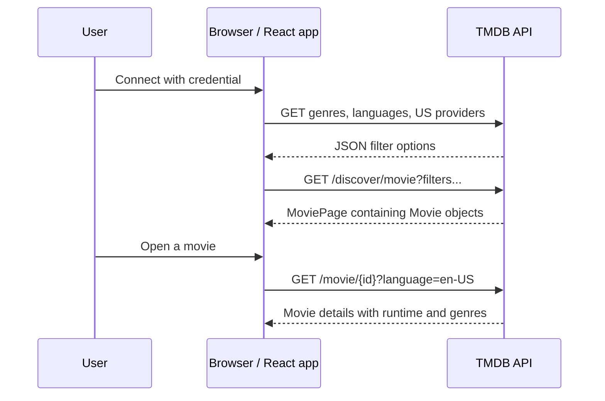

# Veto — client movie catalog API

A responsive Next.js prototype for choosing a movie together. Browse by genre, original language, runtime, release decade, minimum rating, and US streaming service. Save a shortlist on the current device and open movie details before making a decision.

This guide describes the client-side catalog integration used by the Explore and Shortlist tools. The shared-device decision flow is documented in [functional-prototype.md](./functional-prototype.md). In this version, **the user's device calls TMDB directly**. The [server-side branch](https://github.com/david-love121/cs422-project/tree/server-side/prototype) moves those calls and the credential to the server and adds shared caching.

## Run locally

With Nix and flakes enabled:

```sh
cd ~/repos/cs422-project/prototype
nix develop
pnpm install --frozen-lockfile
pnpm dev
```

Or use Node.js 24 and pnpm 11.19 directly:

```sh
pnpm install --frozen-lockfile
pnpm dev
```

Open <http://localhost:3000>. The server binds to `0.0.0.0`, so a phone on the same network can open `http://YOUR_COMPUTER_LAN_IP:3000` if the firewall permits access. Production: `pnpm build && pnpm start`.

## Connect live TMDB data

1. Obtain an **API Read Access Token** from [your TMDB API settings](https://www.themoviedb.org/settings/api).
2. Click **Connect TMDB** in the app, paste it, and click **Connect**. A v3 API key is also accepted.
3. The app validates the credential, loads TMDB genres, languages, and US streaming providers, and queries the Discover API as filters change.

All TMDB API requests execute in the user's browser using `fetch`, including metadata, discovery, and movie details. Posters also load directly from TMDB's image CDN. There are no Next.js API routes, server actions, or server-side TMDB proxies. Credentials are stored in `sessionStorage` for the current tab session, visible to browser code, and sent only to TMDB. No credential is bundled in the app. Disconnect removes the saved credential and returns to demo mode.

This branch does not read a TMDB token from `.env.local`; you enter it through the connection dialog. Since the browser must send the credential, this design does not hide it from someone using that browser or inspecting its network traffic.

Without a credential, the app uses an explicitly labeled local sample collection. Sample streaming assignments are illustrative, not current availability. Live integration requires your TMDB credential; automated tests intercept TMDB requests and do not claim to verify a real account or current catalog.

## How a live request works

The implementation is in [`src/lib/tmdb.ts`](../src/lib/tmdb.ts); the React state and request effects are in [`src/app/page.tsx`](../src/app/page.tsx). Every TMDB request is an HTTP `GET` to `https://api.themoviedb.org/3`, and the response is JSON.

1. On page load, the app starts with local demo data, restores the shortlist, and checks for a credential saved in this tab's `sessionStorage`.
2. Clicking **Connect** tests the entered credential by loading genres, languages, and US providers in parallel. There is no separate login request or TMDB user session. The app considers the connection successful when these metadata requests succeed.
3. The credential is saved, the options populate the filters, and the app requests the first Discover page. The token-change effect also loads metadata, so the current implementation repeats the three metadata requests immediately after a new connection. Reloading a tab with a saved credential loads metadata and discovery again.
4. Changing a filter updates a `Filters` object and resets the page to 1. After a **200 ms debounce**, `buildDiscoverUrl()` converts the object into query parameters and `fetchMovies()` sends it to TMDB. Pagination replaces the visible page rather than appending more cards.
5. The returned `MoviePage.results` becomes the movie grid. Genre IDs are matched to the loaded genre names; posters use separate image CDN URLs.
6. Opening a movie calls `fetchMovieDetails()` for that movie ID. The dialog initially has the selected card's data, then displays the detail response, including runtime. It does not fetch details for every card in advance.



### Authentication on each request

The request helper trims whitespace and removes an optional leading `Bearer ` from the input. It then chooses one of two methods:

| Input | Sent to TMDB |
| --- | --- |
| API Read Access Token | `Authorization: Bearer <YOUR_READ_ACCESS_TOKEN>` header |
| Exactly 32 hexadecimal characters, interpreted as a v3 API key | `api_key=<YOUR_V3_API_KEY>` query parameter |

Both methods also send `Accept: application/json`. `credentials: "omit"` means the request does not send browser cookies; it does **not** remove the explicit Authorization header. The credential identifies the application's TMDB access, not an individual user's movie preferences. This follows TMDB's [application authentication](https://developer.themoviedb.org/docs/authentication-application).

For example, the helper's bearer-token request has this shape. The credential below is only a placeholder:

```http
GET https://api.themoviedb.org/3/genre/movie/list?language=en-US
Accept: application/json
Authorization: Bearer <YOUR_READ_ACCESS_TOKEN>
```

## Endpoints and response objects

An **endpoint** is an API URL for a particular operation. An **envelope** is the outer JSON structure around the useful data. These endpoints do not all use the same envelope: genres use `genres`, providers use `results`, and languages are a plain array. Our functions unwrap or normalize these differences before the UI uses them.

All paths below are relative to `https://api.themoviedb.org/3`. Authentication is added by the shared `request()` helper.

| App function | TMDB endpoint | Raw response → function result |
| --- | --- | --- |
| `fetchMetadata(token, signal?)` | `/genre/movie/list?language=en-US` and `/configuration/languages` | `{ genres: Genre[] }` plus `Language[]` → `{ genres, languages }` |
| `fetchProviders(token, signal?)` | `/watch/providers/movie?watch_region=US&language=en-US` | `{ results: Provider[] }` → sorted `Provider[]` |
| `fetchMovies(token, filters, page = 1, signal?)` | `/discover/movie` with the parameters described below | `MoviePage` → the same shape, with `total_pages` capped at 500 |
| `fetchMovieDetails(token, id, signal?)` | `/movie/{id}?language=en-US` | A detail object with `genres: Genre[]` → `Movie` with an added `genre_ids` array |

`signal?` is an optional browser `AbortSignal` used to cancel a request that is no longer needed. `token` is a local function argument; it is not part of the response objects.

### Genre, Language, and Provider: the filter options

These TypeScript types are the fields our app expects. `[]` means an array, `?` means a property is optional, and `| null` means a property can explicitly contain no value.

```ts
type Genre = {
  id: number;
  name: string;
};

type Language = {
  iso_639_1: string;
  english_name: string;
  name: string;
};

type Provider = {
  provider_id: number;
  provider_name: string;
  logo_path: string | null;
  display_priority?: number;
};
```

| Field | Meaning and use |
| --- | --- |
| `Genre.id` / `name` | TMDB genre identifier and human-readable label. Selecting the label adds its numeric ID to `Filters.genres`. |
| `Language.iso_639_1` | Language code such as `en` or `ja`; selecting it sends `with_original_language`. |
| `Language.english_name` / `name` | English label and native-language label. The selector uses the English label; the helper removes entries missing a code or English name and sorts alphabetically. |
| `Provider.provider_id` / `provider_name` | Streaming service identifier and label. Provider IDs belong to a different list than genre or movie IDs. |
| `Provider.logo_path` | Relative image path, or `null`; the current service selector displays names rather than provider logos. |
| `Provider.display_priority` | Ordering hint. The helper sorts ascending, treats missing priorities as `9999`, and breaks ties by name. The UI then promotes a small preferred list of common services. |

Illustrative, shortened genre response:

```json
{
  "genres": [
    { "id": 16, "name": "Animation" },
    { "id": 35, "name": "Comedy" }
  ]
}
```

Illustrative, shortened language response — notice there is no surrounding object:

```json
[
  { "iso_639_1": "en", "english_name": "English", "name": "English" },
  { "iso_639_1": "ja", "english_name": "Japanese", "name": "日本語" }
]
```

Illustrative, shortened provider response — priorities here are examples, not a current service ranking:

```json
{
  "results": [
    {
      "provider_id": 8,
      "provider_name": "Netflix",
      "logo_path": null,
      "display_priority": 1
    }
  ]
}
```

The provider endpoint supplies the **list of selectable services**, not the services for a particular movie. The app asks Discover to restrict movies by those provider IDs. It does not call a per-movie watch-provider endpoint or obtain playback links. Official references: [genres](https://developer.themoviedb.org/reference/genre-movie-list), [languages](https://developer.themoviedb.org/reference/configuration-languages), and [movie providers](https://developer.themoviedb.org/reference/watch-providers-movie-list).

### Movie and MoviePage: the search results

```ts
type Movie = {
  id: number;
  title: string;
  overview: string;
  poster_path: string | null;
  backdrop_path: string | null;
  release_date: string;
  vote_average: number;
  vote_count: number;
  popularity: number;
  genre_ids: number[];
  original_language: string;
  runtime?: number;
  provider_ids?: number[];
};

type MoviePage = {
  results: Movie[];
  total_results: number;
  total_pages: number;
  page: number;
};
```

| Movie field | Meaning and use |
| --- | --- |
| `id` | TMDB movie ID. Used to open details, deduplicate the shortlist, and build the link to the movie's TMDB page. |
| `title`, `overview` | Movie title and synopsis. Requests ask TMDB for English text with `language=en-US`; the availability of translations depends on TMDB's data. |
| `poster_path`, `backdrop_path` | Relative artwork paths, not complete URLs. Either may be `null`. |
| `release_date` | Date string, normally `YYYY-MM-DD`; it can be empty when unknown. The UI derives the displayed year from it. |
| `vote_average` | TMDB user rating on a 0–10 scale. This is the value controlled by the minimum-rating filter. |
| `vote_count` | Number of votes contributing to the rating. Our Discover query requires at least 100. |
| `popularity` | TMDB's popularity score, separate from the user rating. The default sort uses it. |
| `genre_ids` | Numeric references to the genre list. For example, `16` maps to Animation. |
| `original_language` | Original language code, independent of the language used for title/overview text. It does not describe available dubbing or subtitles. |
| `runtime` | Optional duration in minutes. Discovery omits it; a detail request can supply it. The UI only displays a runtime when the value is truthy. |
| `provider_ids` | Optional field added to our **local demo movies** for sample filtering. It is not provided by the live discovery/detail integration and must not be treated as live availability. |

`MoviePage.results` holds the movies on this page; `total_results` counts all matches, `total_pages` reports the page count, and `page` identifies the current page. The app caps accessible pages at 500, so a large `total_results` is not a promise that every match can be browsed. `results.length` is the number actually returned on the current page, not the total count.

This is an **invented example**, with one fictional movie to keep the JSON short. It is not a current TMDB response or a valid movie recommendation:

```json
{
  "page": 1,
  "total_results": 1,
  "total_pages": 1,
  "results": [
    {
      "id": 123456789,
      "title": "Example Movie",
      "overview": "A fictional synopsis used to explain the API shape.",
      "poster_path": null,
      "backdrop_path": null,
      "release_date": "2018-06-15",
      "vote_average": 7.4,
      "vote_count": 450,
      "popularity": 12.3,
      "genre_ids": [16, 35],
      "original_language": "en"
    }
  ]
}
```

### How movie details differ from discovery

The [movie details endpoint](https://developer.themoviedb.org/reference/movie-details) returns a single object, not a `MoviePage`. It supplies genres as objects and can include runtime. A shortened, fictional detail response might include:

```json
{
  "id": 123456789,
  "title": "Example Movie",
  "genres": [
    { "id": 16, "name": "Animation" },
    { "id": 35, "name": "Comedy" }
  ],
  "runtime": 104
}
```

The detail helper maps `genres` to `genre_ids: [16, 35]`, letting the dialog use the same `Movie` type as the cards. Other fields are retained with object spread. It does not add a provider list or merge the result into every grid card. The example omits the other detail fields for brevity.

These TypeScript definitions describe the fields the UI uses; they are **not exhaustive TMDB schemas or runtime validators**. Extra fields may remain on the returned objects. The helpers check the main list arrays, but do not validate every movie field. In particular, the local type says `runtime?: number`, while unknown runtime from upstream may be `null`; the UI's truthy check tolerates that, but the helper does not convert it. If adding new behavior, validate any additional fields it depends on.

### Images are separate requests

`imageUrl()` joins a checked relative path with `https://image.tmdb.org/t/p/` and a size, defaulting to `w500`. For example, the illustrative path `/example.jpg` would become `https://image.tmdb.org/t/p/w500/example.jpg`. The helper also permits `w780` and `original`. It rejects missing or malformed paths, and the poster component shows a fallback when an image is absent or fails to load. Image requests do not use the TMDB API credential. See TMDB's [image URL format](https://developer.themoviedb.org/docs/image-basics).

## How filters become a Discover request

`Filters` is **our UI input object**, not a response from TMDB. The initial value is:

```ts
const DEFAULT_FILTERS: Filters = {
  genres: [],
  genreMode: "any",
  language: "",
  runtime: "",
  year: "",
  rating: "",
  sort: "popularity.desc",
  providers: [],
};
```

`genres` and `providers` are number arrays, `genreMode` is `"any" | "all"`, and the remaining fields are strings. Empty arrays/strings mean no extra restriction. Although several fields are typed as `string`, the UI offers the specific choices below. `filterBounds()` and `buildDiscoverUrl()` implement the translation into the [Discover API](https://developer.themoviedb.org/reference/discover-movie).

| UI field | Allowed UI values | TMDB query meaning |
| --- | --- | --- |
| `genres` + `genreMode` | Genre IDs; `any` or `all` | `with_genres=16%7C35` means Animation **or** Comedy; `with_genres=16%2C35` means both. `%7C` encodes a pipe and `%2C` encodes a comma. |
| `language` | Empty or a language code | `with_original_language=en`; response text still requests `language=en-US`. |
| `runtime` | Empty, `short`, `medium`, `long`, `epic` | Inclusive bounds: `1–90`, `91–120`, `121–180`, or `181+` minutes, using `with_runtime.gte` and optionally `with_runtime.lte`. |
| `year` | Empty, `2020`, `2010`, `2000`, `1990`, `classic` | Decades use `primary_release_date.gte` and `.lte`. `classic` means through `1989-12-31`. The upper bound never goes beyond today's UTC date. |
| `rating` | Empty, `6`, `7`, `8` | `vote_average.gte=6`, `7`, or `8`; empty adds no minimum average. |
| `sort` | `popularity.desc`, `vote_average.desc`, `primary_release_date.desc`, `title.asc` | Sent as `sort_by`. The helper also accepts ascending/descending popularity, average, release date, title, and vote count; unrecognized values fall back to `popularity.desc`. |
| `providers` | Provider IDs | OR-separated `with_watch_providers`, plus `watch_region=US` and `with_watch_monetization_types=flatrate%7Cfree%7Cads`. Empty adds none of these three parameters. |

Every discovery call also includes `include_adult=false`, `include_video=false`, `vote_count.gte=100`, `language=en-US`, `sort_by`, `page`, and an upper primary-release-date bound. Different filter categories combine to narrow the results: for example, the genre condition **and** the original-language condition must both match.

The builder removes duplicate genre/provider IDs and keeps only positive integers, preserving their first-seen order. It floors a finite page number and clamps it to 1–500; a non-finite page becomes 1. Unrecognized runtime/rating values add no restriction, and an unrecognized year uses the default upper bound of today. It does not perform comprehensive validation of arbitrary user-created `Filters` objects, such as checking whether a language code exists; the UI normally supplies the metadata choices.

### A worked example

Suppose the group selects Animation **or** Comedy, English original language, 91–120 minutes, the 2010s, rating 7+, Netflix, and highest rating first:

```json
{
  "genres": [16, 35],
  "genreMode": "any",
  "language": "en",
  "runtime": "medium",
  "year": "2010",
  "rating": "7",
  "sort": "vote_average.desc",
  "providers": [8]
}
```

On a date after the end of 2019, `buildDiscoverUrl(filters, 1)` builds this request URL (authentication is added separately):

```text
https://api.themoviedb.org/3/discover/movie?language=en-US&include_adult=false&include_video=false&vote_count.gte=100&sort_by=vote_average.desc&page=1&primary_release_date.lte=2019-12-31&primary_release_date.gte=2010-01-01&with_genres=16%7C35&with_original_language=en&with_runtime.gte=91&with_runtime.lte=120&vote_average.gte=7&with_watch_providers=8&watch_region=US&with_watch_monetization_types=flatrate%7Cfree%7Cads
```

TMDB does the filtering, including runtime, even though Discover does not return runtime in each movie. The response contains matching movies, not a record of which filters each movie passed. Selecting “Must include every selected genre” changes only the genre separator from a pipe to a comma. Adding another service uses OR matching between provider IDs.

Streaming is fixed to **USA**. The monetization choices mean subscription (`flatrate`), free, or ad-supported streaming; rental/purchase-only offers are excluded when a service filter is active. With no selected service, there is no streaming-availability restriction at all. Availability can change, and a provider match does not guarantee that a specific subscription tier includes the movie.

## Storage, caching, and errors

| Data | Where it lives | Lifetime / behavior |
| --- | --- | --- |
| TMDB credential | React state and `sessionStorage`, key `movie-night-tmdb-token` | Restored across reloads in the current tab session. Disconnect removes it; if storage is unavailable, it can remain only in memory. |
| Shortlist | React state and `localStorage`, key `movie-night-shortlist-v1` | Persists on the same browser/origin across sessions. Stores movie snapshots, not a TMDB account list, and is independent of the active filters. Restore checks a few fields and keeps at most 100 entries. |
| Filters, metadata, current movie page, open details | React state | Temporary UI data; filters reset on reload. A new request replaces the current result page. |

There is **no application-managed response cache** on this branch: no shared server cache, fetch memoization, IndexedDB response store, or explicit cache TTL. Returning to a filter/page or reopening a movie issues another `fetch`; the browser or TMDB may still apply ordinary HTTP caching. The currently displayed React state and the saved shortlist are not a shared API cache. This is why the server-side branch adds caching for common requests such as the landing page.

When filters change during the 200 ms debounce, the old timer is cleared. If a request already started, its `AbortController` is aborted and the UI checks the signal before applying a result, preventing stale results from replacing a newer selection. Closing details, changing the selected movie, changing tokens, or unmounting also cleans up the associated requests. Cancellation can stop the browser from waiting for a result; it does not guarantee TMDB had not already processed the request.

The shared request helper turns failures into messages the UI can show:

| Failure | App behavior |
| --- | --- |
| HTTP 401 or 403 | Reports an unaccepted credential. |
| HTTP 404 | Reports an unavailable catalog item. |
| HTTP 429 | Asks the user to wait before retrying; there is no automatic backoff. |
| HTTP 500+ | Reports a temporary TMDB outage. |
| Other unsuccessful HTTP status | Reports the status and suggests adjusting filters. |
| Fetch/network failure | Reports a connection problem. |
| Invalid JSON or missing expected list array | Reports unreadable/unexpected data. |
| Request deliberately aborted | Does not show a connection error or apply that result. |

Connect errors stay in the connection dialog. Discover errors offer a manual retry. Detail errors appear in the movie dialog. A metadata-refresh failure after token restoration is currently swallowed by that effect; the discovery request reports its own failure separately. There is no automatic switch back to demo on an invalid live credential. Native dialogs provide focus containment and Escape dismissal, and the mobile filter sheet uses the same request logic as desktop.

To observe the API yourself, open the browser's developer tools → **Network**, filter for `api.themoviedb.org`, connect, change a filter, and inspect the request URL and JSON response. Open a movie to compare `/discover/movie` with `/movie/{id}`. Requests may contain your credential, so omit authentication headers, `api_key`, and stored tokens from any screenshots or exported network logs you share.

Explore and Shortlist provide catalog browsing. The separate Decide together workspace implements shared-device group voting; see the [functional prototype guide](./functional-prototype.md). Multi-device rooms remain outside the prototype.

## Validation

```sh
pnpm lint
pnpm typecheck
pnpm build
pnpm exec playwright install chromium
pnpm test:e2e
```

Keep a server running at `http://localhost:3000` for browser tests. For a production preview, stop the development server, run `pnpm build`, then `pnpm start` in a separate terminal. Avoid building while the development server is running. The retained catalog tests cover desktop and mobile filtering, shortlist persistence, connection failures, and direct TMDB requests with mocked responses. Shared-device decision tests are described separately in the functional prototype guide. On NixOS, use a system Chromium binary:

```sh
PLAYWRIGHT_CHROMIUM_EXECUTABLE_PATH="$(command -v chromium)" pnpm test:e2e
```

## Structure

- `src/app/page.tsx` — client-side interface, state, persistence, and requests.
- `src/app/globals.css` — responsive visual design and mobile filter sheet.
- `src/lib/tmdb.ts` — TMDB types, request builder, authentication, and errors.
- `src/lib/demo.ts` — local sample collection and matching logic.
- `tests/prototype.spec.ts` — browser interaction and request-contract tests.
- `flake.nix` / `flake.lock` — pinned Nix development environment.

## Data and attribution

This product uses the TMDB API but is not endorsed or certified by TMDB. Movie information and artwork belong to their respective owners. Streaming availability is provided by [JustWatch](https://www.justwatch.com/).

Reference: [TMDB Discover API](https://developer.themoviedb.org/reference/discover-movie), [authentication](https://developer.themoviedb.org/docs/authentication-application), [watch providers](https://developer.themoviedb.org/reference/watch-providers-movie-list), and [official logos](https://www.themoviedb.org/about/logos-attribution).
